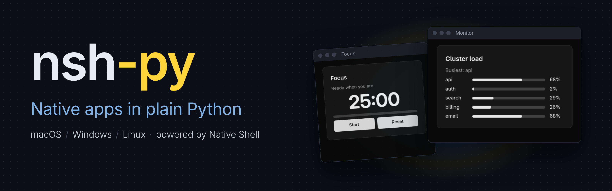

# nsh-py



**Native apps in plain Python.** nsh-py brings [Native Shell (NSH)](https://nsh.dev) to Python: you write
functions, signals and Tailwind classes, and get a real native window on macOS (AppKit), Windows (Win32) and
Linux (GTK 4), with the platform's own text, input and accessibility. No web view, no JavaScript, nothing to
compile: wheels come prebuilt.

The monitor in the banner is the whole program below. A timer changes one signal, and every bar, label and the
"Busiest" line follow it, with no callbacks to wire up:

```python
import random

import nsh

SERVICES = ["api", "auth", "search", "billing", "email"]


def jiggle(load):
    return {s: min(98, max(2, n + random.randint(-15, 15))) for s, n in load.items()}


def Monitor():
    load = nsh.signal(dict.fromkeys(SERVICES, 40))
    nsh.set_interval(0.5, lambda: load.update(jiggle))
    busiest = nsh.computed(lambda: max(load(), key=load().get))

    def row(service):
        def pct():
            return load()[service]

        return nsh.view(
            nsh.text(service, class_="w-16"),
            nsh.progress(pct, class_="flex-1"),
            nsh.text(lambda: f"{pct()}%", class_="w-10"),
            class_="flex-row items-center gap-3",
        )

    return nsh.card(
        *[row(s) for s in SERVICES],
        title="Cluster load",
        description=lambda: f"Busiest: {busiest()}",
        class_="m-6 w-96",
    )


nsh.run(Monitor, title="Monitor")
```

More in [`examples/`](examples/): a focus timer, a task list, a poll, a DataFrame viewer.

## Features

- **Plain Python:** components are functions (or [classes](#prefer-object-oriented)), state is `nsh.signal`,
  and anything that should update is a lambda. Computeds, effects and timers are built in, and signals can be written from any thread.
- **Native, not a web view:** NSH draws with each platform's own views, so apps start fast and feel at
  home.
- **Styled with Tailwind classes:** `class_="p-4 gap-2 rounded-xl"`, with a light and dark theme. Ready-made
  components (`card`, `table`, `button`, `checkbox`, `switch`, `progress`, `input`) look right out of the box.
- **Tested headless:** `nsh.testing` runs your app without a window, so pytest can press buttons and type text
  in CI.

The smallest app is a counter:

```python
import nsh

def Counter():
    count = nsh.signal(0)
    return nsh.view(
        nsh.text(lambda: f"Count: {count()}", class_="text-xl"),
        nsh.button("+1", on_press=lambda: count.update(lambda n: n + 1)),
        class_="p-4 gap-2",
    )

nsh.run(Counter, title="Counter")
```

Prefer named functions to lambdas? Decorators do the same job, and you can
mix both styles freely:

```python
def Counter():
    count = nsh.signal(0)

    @nsh.computed              # cached: recomputed only when count changes
    def label():
        return f"Count: {count()}"

    @count.updater             # a handler for on_press
    def increment(n):
        return n + 1

    return nsh.view(
        nsh.text(label),
        nsh.button("+1", on_press=increment),
        nsh.button("Reset", on_press=count.setter(0)),
    )
```

`count.value` reads and writes too (`count.value += 1` in a handler), and
`count.map(fn)` is a one-line computed. Full example:
[`examples/counter_decorators.py`](examples/counter_decorators.py).

## Prefer object-oriented?

Write components as classes with `nsh.Component`. Annotated class
attributes are the state: reading `self.seconds` reads it, and assigning
`self.seconds += 1` redraws whatever shows it.

```python
import nsh

class Stopwatch(nsh.Component):
    label: str = "Stopwatch"  # a prop: Stopwatch(label="Tea")
    seconds: int = 0
    running: bool = False

    def setup(self):  # runs once, before view()
        nsh.set_interval(1, self.tick)

    def tick(self):
        if self.running:
            self.seconds += 1

    def toggle(self):
        self.running = not self.running

    def reset(self):
        self.seconds = 0

    @property
    def clock(self):  # follows seconds, like a computed
        return f"{self.seconds // 60:02}:{self.seconds % 60:02}"

    def view(self):
        return nsh.card(
            nsh.text(lambda: self.clock, class_="text-4xl font-bold"),
            nsh.view(
                nsh.button(lambda: "Pause" if self.running else "Start", on_press=self.toggle),
                nsh.button("Reset", on_press=self.reset),
                class_="flex-row gap-2",
            ),
            title=self.label,
        )


def App():
    return nsh.view(Stopwatch(label="Tea"), Stopwatch(label="Eggs"), class_="p-4 gap-4")


nsh.run(App, title="Stopwatches")
```

- **State:** each annotated attribute (`seconds: int = 0`) is a signal, one per
  instance, so the two stopwatches tick on their own. Unannotated attributes are
  plain constants.
- **Props:** `Stopwatch(label="Tea")` sets a starting value. An attribute with no
  default must be passed, and passing a signal (`Stopwatch(seconds=shared)`) shares
  the caller's state.
- **`setup()`** runs once, before `view()`: start timers and effects there.
- **`view()`** runs once too. Read state inside lambdas (`lambda: self.clock`) to
  keep it live; a plain `self.clock` is read once.
- **`self.signals.<name>`** is an attribute's signal, for widgets that take one:
  `nsh.checkbox("Done", checked=self.signals.done)`.
- Changing a list in place (`self.items.append(x)`) doesn't redraw: assign a new
  one (`self.items = [*self.items, x]`).

Classes and functions are the same thing written two ways, with the same speed
(nothing re-renders; the lambdas update), so mix them freely. The counter as a
class: [`examples/counter_class.py`](examples/counter_class.py).

## Hot reload

Keep the window open while you edit: save the file and the app redraws
with the new code.

```sh
python -m nsh.reload app.py        # or nsh.run(App, reload=True) in the script
```

Local modules the script imports reload too. Signals keep their values,
so a running timer keeps running while you restyle it; a signal whose
initial value changes type starts over. A broken edit keeps the old view
up and logs the error. In the Python-only setup, use
`uv run --no-project python tools/run.py --reload app.py`.

## Install (experimental)

nsh-py is not on PyPI. Prebuilt wheels (one per platform, Python 3.10+) are
published on [GitHub Releases](https://github.com/lucianosrp/nsh-py/releases),
and you install them with [uv](https://docs.astral.sh/uv/) pointed at a release:

```sh
uv pip install nsh-py --no-index \
  --find-links https://github.com/lucianosrp/nsh-py/releases/expanded_assets/latest
```

`--no-index` keeps uv off PyPI: nsh-py has no dependencies, and the name
`nsh-py` isn't ours on PyPI, so a package uploaded there under that name must
never win. `latest` is a rolling tag that always holds the newest release; to
pin one, use its tag instead (`.../expanded_assets/v0.1.0`).

In a uv project, declare the release as an *explicit* index and pin nsh-py to
it, so uv takes nsh-py from GitHub only (your other dependencies still come
from PyPI), then `uv add nsh-py`:

```toml
[[tool.uv.index]]
name = "nsh-py"
url = "https://github.com/lucianosrp/nsh-py/releases/expanded_assets/latest"
format = "flat"
explicit = true

[tool.uv.sources]
nsh-py = { index = "nsh-py" }
```

For the newest build of `main` (not a release), use the tag `dev-core`.

Requirements: macOS 14+, Windows 10 1809+, or Linux with GTK 4.14+ and glibc
2.39+ (Ubuntu 24.04+, Debian 13, Fedora 40+, Arch). The Linux wheels are tagged
`linux_x86_64` because GTK can't be bundled, which is another reason they live
on GitHub and not on PyPI.

To work on nsh-py itself, see [SPRINT.md](SPRINT.md).

> Early work in progress, built toward a PyCon sprint. Not affiliated with Longbridge.
