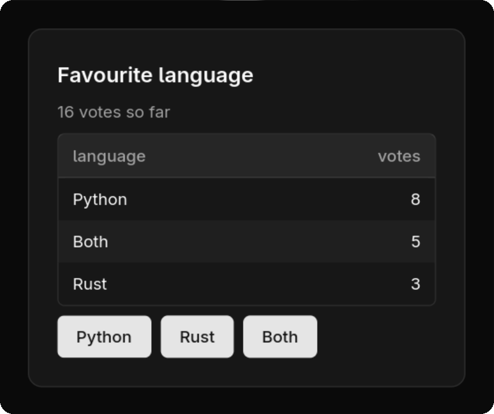

# nsh-py

Native UIs in plain Python, powered by [Native Shell (NSH)](https://nsh.dev).

<table>
<tr>
<td>

```python
import nsh

def Poll():
    votes = nsh.signal({"Python": 8, "Rust": 3, "Both": 5})

    @nsh.computed
    def rows():
        ranked = sorted(votes().items(), key=lambda kv: -kv[1])
        return [{"language": k, "votes": n} for k, n in ranked]

    def vote(choice):
        return lambda: votes.update(lambda v: {**v, choice: v[choice] + 1})

    buttons = [nsh.button(k, on_press=vote(k)) for k in votes.value]
    return nsh.card(
        nsh.table(rows),
        nsh.view(*buttons, class_="flex-row gap-2"),
        title="Favourite language",
        description=lambda: f"{sum(votes().values())} votes so far",
        class_="m-6",
    )

nsh.run(Poll, title="Poll")
```

</td>
<td>



</td>
</tr>
</table>

A signal holds the votes. The table, the total and the order follow it,
and a press re-sorts the table: no callbacks to wire up. The code is
[`examples/poll.py`](examples/poll.py).

The smallest app is a counter:

```python
import nsh

def Counter():
    count = nsh.signal(0)
    return nsh.view(
        nsh.text(lambda: f"Count: {count()}", class_="text-xl"),
        nsh.button("+1", on_press=lambda: count.update(lambda n: n + 1)),
        class_="p-4 gap-2",
    )

nsh.run(Counter, title="Counter")
```

Prefer named functions to lambdas? Decorators do the same job, and you can
mix both styles freely:

```python
def Counter():
    count = nsh.signal(0)

    @nsh.computed              # cached: recomputed only when count changes
    def label():
        return f"Count: {count()}"

    @count.updater             # a handler for on_press
    def increment(n):
        return n + 1

    return nsh.view(
        nsh.text(label),
        nsh.button("+1", on_press=increment),
        nsh.button("Reset", on_press=count.setter(0)),
    )
```

`count.value` reads and writes too (`count.value += 1` in a handler), and
`count.map(fn)` is a one-line computed. Full example:
[`examples/counter_decorators.py`](examples/counter_decorators.py).

## Install (experimental)

nsh-py is not on PyPI. Prebuilt wheels (one per platform, Python 3.10+) are
published on [GitHub Releases](https://github.com/lucianosrp/nsh-py/releases),
and you install them with [uv](https://docs.astral.sh/uv/) pointed at a release:

```sh
uv pip install nsh-py --no-index \
  --find-links https://github.com/lucianosrp/nsh-py/releases/expanded_assets/latest
```

`--no-index` keeps uv off PyPI: nsh-py has no dependencies, and the name
`nsh-py` isn't ours on PyPI, so a package uploaded there under that name must
never win. `latest` is a rolling tag that always holds the newest release; to
pin one, use its tag instead (`.../expanded_assets/v0.1.0`).

In a uv project, declare the release as an *explicit* index and pin nsh-py to
it, so uv takes nsh-py from GitHub only (your other dependencies still come
from PyPI), then `uv add nsh-py`:

```toml
[[tool.uv.index]]
name = "nsh-py"
url = "https://github.com/lucianosrp/nsh-py/releases/expanded_assets/latest"
format = "flat"
explicit = true

[tool.uv.sources]
nsh-py = { index = "nsh-py" }
```

For the newest build of `main` (not a release), use the tag `dev-core`.

Requirements: macOS 14+, Windows 10 1809+, or Linux with GTK 4.14+ and glibc
2.39+ (Ubuntu 24.04+, Debian 13, Fedora 40+, Arch). The Linux wheels are tagged
`linux_x86_64` because GTK can't be bundled, which is another reason they live
on GitHub and not on PyPI.

To work on nsh-py itself, see [SPRINT.md](SPRINT.md).

> Early work in progress, built toward a PyCon sprint. Not affiliated with Longbridge.
